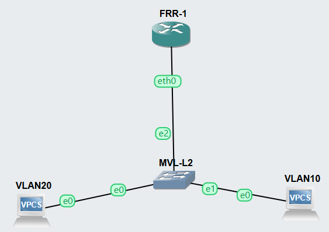

# 802.1Q Router-on-a-Stick (FRR + GNS3 built-in switch)

Inter-VLAN routing between VLAN 10 and VLAN 20 using one FRR router connected to an 802.1Q trunk. The lab runs on the GNS3 server on the Ubuntu VM (`192.168.56.102:3080`, see [../../OS/Ubuntu/GNS3-FRR-Ubuntu-26.04-Setup.md](../../OS/Ubuntu/GNS3-FRR-Ubuntu-26.04-Setup.md)).

## Topology



The screenshot shows the **FRR-on-Stick** project in the GNS3 web UI. Each node has a colored note with its addresses, switch ports, role and test commands, added by [notes.sh](notes.sh).

| Node | Type | Console | Port | Connects to |
|---|---|---|---|---|
| FRR-1 | QEMU, `frr-8.2.2.qcow2` | telnet `192.168.56.102:5000` | eth0 | MVL-L2 Ethernet2 |
| MVL-L2 | Ethernet switch (built-in) | telnet `192.168.56.102:5002` | Ethernet0 / 1 / 2 | VLAN20 / VLAN10 / FRR-1 |
| VLAN10 | VPCS | telnet `192.168.56.102:5003` | e0 | MVL-L2 Ethernet1 |
| VLAN20 | VPCS | telnet `192.168.56.102:5005` | e0 | MVL-L2 Ethernet0 |

[notes.sh](notes.sh) adds a text note beside each node in the **FRR-on-Stick** project, with its addresses, ports, role and test commands. It needs only `curl` and `perl` (Git Bash works). It's safe to re-run: it replaces only its own notes and leaves hand-made labels alone.

## Addressing

| VLAN | Subnet | Gateway (FRR-1) | PC |
|---|---|---|---|
| 10 | 192.168.10.0/24 | eth0.10, 192.168.10.1 | VLAN10, 192.168.10.10 |
| 20 | 192.168.20.0/24 | eth0.20, 192.168.20.1 | VLAN20, 192.168.20.10 |

---

## 1. Open the consoles

In the GNS3 web UI (`http://192.168.56.102:3080`), right-click a node and choose **Web console**. You can also connect from Windows:

```
telnet 192.168.56.102 <port>
```

Use the ports from the topology table. In PuTTY, choose connection type **Telnet**.

- **A blank VPCS console is normal.** VPCS prints nothing until you press a key, so press **Enter** to get the `VLAN10>` prompt.
- **VPCS allows only one console connection.** Close any other open console to the same PC, or the new one stays silent.
- **In the web UI, plain "Console" launches a local telnet program.** If nothing opens, use **Web console** instead.

## 2. Configure VLANs on MVL-L2

MVL-L2 is the GNS3 built-in Ethernet switch. It has no Cisco-style CLI, and its telnet console can't configure VLANs. Set VLANs in the GUI instead.

> **The web UI won't edit a switch that has links attached.** If you try, it shows *"Can't modify a switch already connected."* and saves nothing. Remove the links first, configure the switch, then reconnect.

1. **Delete the links to MVL-L2.** Right-click each cable and choose **Delete**, or click the cable and press the **Delete** key. Right-click the line itself, not a device or a port label.
2. Right-click **MVL-L2** and choose **Configure**.
3. In the ports table, click the trash icon for ports **0, 1 and 2**. Then re-add each port with the fields below the table, clicking **Add** after each one:

   | Port | VLAN | Type |
   |---|---|---|
   | 0 | 20 | access |
   | 1 | 10 | access |
   | 2 | 1 | dot1q |

4. Click **Apply**. If you close the dialog with Cancel or ✕, it throws away your edits.
5. **Reconnect the links:**
   - VLAN20 e0 → MVL-L2 **Ethernet0**
   - VLAN10 e0 → MVL-L2 **Ethernet1**
   - FRR-1 **eth0** → MVL-L2 **Ethernet2**

To check the result, open **Configure** again, or look at `ports_mapping` for MVL-L2 at:

```
http://192.168.56.102:3080/v2/projects/<project-id>/nodes
```

## 3. Configure router-on-a-stick on FRR-1

Log in as `root`. If the console opens at the `frr#` prompt (vtysh), type `exit` to get a Linux shell.

**Create the 802.1Q subinterfaces in the Linux shell.** vtysh can't create them.

```sh
modprobe 8021q            # VLAN support (an error here is fine if it's built in)
ip link set eth0 up
ip link add link eth0 name eth0.10 type vlan id 10
ip link add link eth0 name eth0.20 type vlan id 20
ip link set eth0.10 up
ip link set eth0.20 up
sysctl -w net.ipv4.ip_forward=1
```

**Assign the gateway addresses in vtysh:**

```
vtysh
conf t
 interface eth0.10
  ip address 192.168.10.1/24
 exit
 interface eth0.20
  ip address 192.168.20.1/24
 exit
end
write memory
show interface brief
show ip route
```

`show ip route` should list `192.168.10.0/24` and `192.168.20.0/24` as connected (`C`).

**After a reboot:** `write memory` saves the IP addresses to `/etc/frr/frr.conf`, but the `eth0.10` and `eth0.20` subinterfaces are lost. After FRR-1 restarts, run the shell commands above again, or put them in a startup script. On Alpine-based images, use `/etc/local.d/vlan.start` (make it executable) and run `rc-update add local default`.

## 4. Configure the PCs

**VLAN10:**

```
ip 192.168.10.10/24 192.168.10.1
save
```

**VLAN20:**

```
ip 192.168.20.10/24 192.168.20.1
save
```

## 5. Verify

From **VLAN10**:

```
ping 192.168.10.1       # its own gateway, same VLAN
ping 192.168.20.1       # FRR's VLAN 20 interface
ping 192.168.20.10      # PC in the other VLAN, routed
trace 192.168.20.10     # first hop should be 192.168.10.1
```

From **VLAN20**, run `ping 192.168.10.10`.

## Troubleshooting

| Symptom | Cause / fix |
|---|---|
| Switch changes don't save; *"Can't modify a switch already connected."* | Links are attached. Delete them, configure, click **Apply**, then reconnect (section 2). |
| Switch Configure: adding a port that already exists does nothing | Delete the existing row with the trash icon first, then **Add** it again. |
| VPCS console opens but stays blank | Press **Enter**. Close any other console to the same PC. Use **Web console**. |
| PC can't ping its gateway | Check that switch port 2 is `dot1q`, the PC's port has the right access VLAN, and the cable is on the right port. Run `ip -d link show eth0.10` on FRR-1. |
| PC reaches its gateway but not the other VLAN | Check `sysctl net.ipv4.ip_forward` (must be `1`), check both PCs have a gateway set (`show ip` in VPCS), and run `show ip route` in vtysh. |
| Everything stops working after FRR-1 restarts | The subinterfaces aren't persistent. Re-run the `ip link` commands (section 3). |
