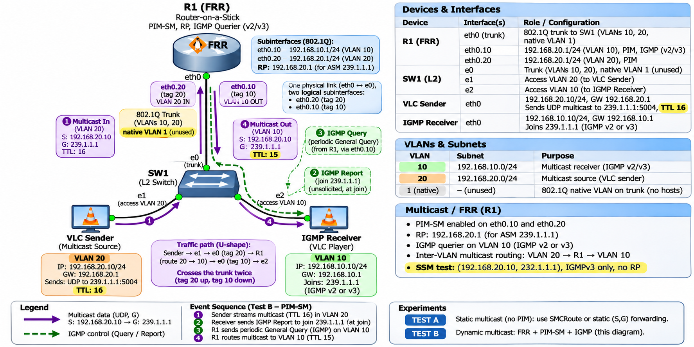

# Inter-VLAN Multicast on a Stick (FRR + Cisco IOSvL2)

One FRR router routes a multicast stream from VLAN 20 to VLAN 10 over a single 802.1Q trunk. The switch is a Cisco IOSvL2, so you also get real IGMP snooping and a Cisco CLI.

| Part | Job |
|---|---|
| **R1 (FRR)** | Router-on-a-stick (`eth0.10`, `eth0.20`), PIM-SM, RP `192.168.20.1`, IGMP querier on VLAN 10 |
| **SW1 (IOSvL2)** | VLAN 10 and 20, trunk to R1, IGMP snooping |
| **VLC Sender** | Streams UDP to `239.1.1.1:5004` with TTL 16 in VLAN 20 |
| **IGMP Receiver** | Joins `239.1.1.1` (IGMPv2 or v3) in VLAN 10 and plays the stream |

The stream crosses the trunk twice: up tagged 20, routed by R1, back down tagged 10. R1 decrements the TTL from 16 to 15.

## Topology



> **The diagram has one typo.** In the *Devices & Interfaces* table, `eth0.10` shows `192.168.20.1/24`. The correct address is **`192.168.10.1/24`**, as in the left side of the diagram.

### Nodes

| Node | GNS3 node | RAM |
|---|---|---|
| R1 | FRR 8.2.2 (QEMU) | 128 MB |
| SW1 | Cisco IOSvL2 (QEMU, `vios_l2-adventerprisek9-m.ssa.high_iron_20200929.qcow2`) | 768 MB |
| VLC Sender | Linux host (an FRR appliance with all FRR daemons off) | 256 MB |
| IGMP Receiver | Linux host | 256 MB |

VPCS can't send or join multicast, so both hosts must be Linux hosts.

### Links and addressing

| Link | A | B (SW1) | SW1 port mode |
|---|---|---|---|
| R1 – SW1 | R1 eth0 | **Gi0/0** (e0) | trunk, VLANs 10, 20, native VLAN 1 |
| Sender – SW1 | Sender eth0 | **Gi0/1** (e1) | access VLAN 20 |
| Receiver – SW1 | Receiver eth0 | **Gi0/2** (e2) | access VLAN 10 |

| VLAN | Subnet | Gateway (R1) | Host |
|---|---|---|---|
| 10 | 192.168.10.0/24 | eth0.10, 192.168.10.1 | IGMP Receiver, 192.168.10.10 |
| 20 | 192.168.20.0/24 | eth0.20, 192.168.20.1 (also the RP) | VLC Sender, 192.168.20.10 |
| 1 | — | — | Native VLAN on the trunk, no hosts |

---

## 1. Add the IOSvL2 template

The IOSvL2 image is Cisco software. It isn't in this repo, and GNS3 can't download it for you. Get it from a Cisco account with CML access (Cisco Modeling Labs ships it as `vios_l2-…qcow2`).

1. In GNS3, choose **File → Import appliance** and open [appliances/cisco-iosvl2.gns3a](../../appliances/cisco-iosvl2.gns3a).
2. Choose the server that will run the lab.
3. Pick version **15.2(20200924:215240)**. Its file, `vios_l2-adventerprisek9-m.ssa.high_iron_20200929.qcow2`, shows as **Missing**. Click **Import** and select the file you got from Cisco. GNS3 checks the MD5 (`99ecab32de12410c533e6abd4e9710aa`).
4. Finish the wizard. **Cisco IOSvL2** appears under **Switches**.

**KVM and memory.** The appliance sets `kvm: require` and 768 MB of RAM.

- If the server has no KVM, the node won't start. In the template, go to **Configure template → Advanced** and remove the KVM requirement, or clear **Enable hardware acceleration** under **Edit → Preferences → QEMU**. IOSvL2 then runs under pure emulation, and it takes several minutes to boot.
- All four nodes need about 1.4 GB of RAM, plus QEMU overhead. On the 1.6 GB Ubuntu VM, add the 2 GB swapfile from the [PIM-SM lab](../PIM-SM-Multicast/README.md#1-build-the-topology-in-gns3) and stop other labs first.

## 2. Build the topology

1. Add **R1** (FRR), **SW1** (Cisco IOSvL2), and two more FRR nodes named **VLC-Sender** and **IGMP-Receiver**.
2. Set the RAM from the nodes table: right-click the node, choose **Configure**, then set **RAM**.
3. Cable everything as in the links table. IOSvL2 ports are named `Gi0/0`, `Gi0/1`, and so on, so diagram port `e0` is `Gi0/0`.
4. Start all nodes. Wait for SW1 to print the `Switch>` prompt. Under emulation this can take 5–10 minutes.

## 3. Configure SW1 (IOSvL2)

Open the SW1 console. If it asks `Would you like to enter the initial configuration dialog? [yes/no]:`, answer `no`.

```
enable
configure terminal
  (paste the contents of configs/SW1.cfg)
end
write memory
```

The full config is in [configs/SW1.cfg](configs/SW1.cfg). The lines that matter:

| Command | Why |
|---|---|
| `vlan 10` / `vlan 20` | Creates the VLANs. An access port in a VLAN that doesn't exist forwards nothing. |
| `switchport trunk encapsulation dot1q` | IOSvL2 also supports ISL, so it refuses `switchport mode trunk` until you choose an encapsulation. Enter this line first. |
| `switchport trunk allowed vlan 10,20` | Carries only the two lab VLANs. Native VLAN 1 remains the untagged VLAN but carries no traffic. |
| `switchport nonegotiate` | Turns off DTP. FRR doesn't speak DTP, so this keeps the port a trunk without negotiating. |
| `spanning-tree portfast edge` | Host ports start forwarding at once, instead of after about 30 seconds of STP listening and learning. |
| `ip igmp snooping` | On by default. SW1 forwards group traffic only to ports that joined, plus the router port. |

**Check:**

```
show vlan brief                 ! Gi0/1 in VLAN 20, Gi0/2 in VLAN 10
show interfaces trunk           ! Gi0/0 trunking, 802.1q, allowed and active: 10,20
show spanning-tree vlan 10      ! Gi0/0 and Gi0/2 forwarding (FWD)
```

## 4. Configure R1 (FRR)

The FRR console opens at `frr#` (vtysh). Type `exit` to get a Linux shell.

**Daemons, subinterfaces and kernel settings.** These go in a startup script, because the subinterfaces don't survive a reboot:

```sh
sed -i -E 's/^(bgpd|ospfd|ospf6d|ripd|ripngd|isisd|ldpd|bfdd|eigrpd)=yes/\1=no/; s/^pimd=no/pimd=yes/' /etc/frr/daemons

cat > /etc/local.d/lab.start <<'EOF'
#!/bin/sh
modprobe 8021q 2>/dev/null
ip link set eth0 up
ip link add link eth0 name eth0.10 type vlan id 10 2>/dev/null
ip link add link eth0 name eth0.20 type vlan id 20 2>/dev/null
ip link set eth0.10 up
ip link set eth0.20 up
for f in /proc/sys/net/ipv4/conf/*/rp_filter; do echo 0 > $f; done
sysctl -qw net.ipv4.ip_forward=1
EOF
chmod +x /etc/local.d/lab.start
rc-update add local default
/etc/local.d/lab.start
rc-service frr restart
```

**Routing, PIM and IGMP:**

```
vtysh
configure terminal
  (paste the contents of configs/R1.conf)
end
write memory
```

[configs/R1.conf](configs/R1.conf) does the following:

- **`ip pim` on both subinterfaces.** On `eth0.20`, R1 is the first-hop router and the RP. On `eth0.10`, it's the last-hop router. The PIM hellos also show SW1 where the router port is (step 6).
- **`ip igmp` with version 3 on `eth0.10`.** R1 becomes the IGMP querier for VLAN 10. An IGMPv3 router also accepts v2 reports, so both receiver tests work without changing R1.
- **`ip igmp query-interval 30`.** General queries go out every 30 seconds instead of every 125, so snooping and group state recover faster in the lab.
- **`ip pim rp 192.168.20.1 239.0.0.0/8`.** The RP is R1's own VLAN 20 address. `232.0.0.0/8` is FRR's default SSM range, and it never uses an RP.

## 5. Configure the hosts

On each host, `exit` to the shell. Turn FRR off and set the address. To keep these settings after a reboot, put them in `/etc/local.d/lab.start` as in step 4.

**VLC-Sender:**

```sh
sed -i -E 's/^([a-z0-9]+d)=yes/\1=no/' /etc/frr/daemons && rc-service frr restart
ip link set eth0 up
ip addr add 192.168.20.10/24 dev eth0
ip route replace default via 192.168.20.1
```

**IGMP-Receiver:**

```sh
sed -i -E 's/^([a-z0-9]+d)=yes/\1=no/' /etc/frr/daemons && rc-service frr restart
ip link set eth0 up
ip addr add 192.168.10.10/24 dev eth0
ip route replace default via 192.168.10.1
sysctl -w net.ipv4.icmp_echo_ignore_broadcasts=0    # reply to pings sent to the group
```

**Choose the receiver's IGMP version.** Linux uses IGMPv3 by default.

```sh
sysctl -w net.ipv4.conf.eth0.force_igmp_version=2   # IGMPv2
sysctl -w net.ipv4.conf.eth0.force_igmp_version=0   # back to the default (v3)
```

Check unicast first. From the receiver, `ping 192.168.20.10` should get replies through R1.

## 6. Test B: PIM-SM (the diagram)

The four steps from the diagram's event sequence:

**① and ② The receiver joins.** On IGMP-Receiver:

```sh
ip addr add 239.1.1.1/32 dev eth0 autojoin     # sends an unsolicited IGMP report
```

**③ R1 queries.** Wait up to 30 seconds, then check:

| Where | Command | Expect |
|---|---|---|
| R1 | `show ip igmp interface` | `eth0.10` is the querier, at 192.168.10.1 |
| R1 | `show ip igmp groups` | `239.1.1.1` on `eth0.10` |
| R1 | `show ip pim rp-info` | RP `192.168.20.1` for `239.0.0.0/8` |
| SW1 | `show ip igmp snooping mrouter` | VLAN 10 and VLAN 20 → **Gi0/0** (learned from R1's PIM hellos and queries) |
| SW1 | `show ip igmp snooping groups` | VLAN 10, `239.1.1.1`, port **Gi0/2** |

**④ The sender sends.** On VLC-Sender, use ping as a quick test:

```sh
ping -t 16 -I eth0 239.1.1.1
```

Replies come back from `192.168.10.10`. Linux sends multicast with TTL 1 by default, so `-t 16` is needed. With TTL 1, R1 would drop the packets.

On R1:

```
show ip mroute                  ! (192.168.20.10, 239.1.1.1)  iif eth0.20  oif eth0.10
show ip pim upstream            ! (S,G) Joined
```

### Stream video with VLC

Install VLC on both hosts. The [eBGP + PIM-SM lab, step 7](../eBGP-PIM-SM/README.md#7-stream-video-with-vlc) covers it: 256 MB of RAM, a temporary NAT link, `apk add vlc`, a `vlc` user, and the test clip.

Start the receiver first:

```sh
su vlc -c "cvlc -I dummy udp://@239.1.1.1:5004 --sout file/ts:/tmp/rx.ts"
```

Then start the sender:

```sh
su vlc -c "cvlc -I dummy --loop /home/vlc/bbb.mp4 --sout '#std{access=udp,mux=ts,dst=239.1.1.1:5004}' --ttl=16"
```

While the stream runs, `ls -la /tmp/rx.ts` on the receiver shows the file growing.

### SSM test: (192.168.20.10, 232.1.1.1), IGMPv3 only, no RP

With SSM, the receiver names the source as well as the group. That needs IGMPv3, so set `force_igmp_version=0` on the receiver first.

Receiver (VLC's `source@group` syntax sends an IGMPv3 source-specific join):

```sh
su vlc -c "cvlc -I dummy udp://192.168.20.10@232.1.1.1:5004 --sout file/ts:/tmp/rx-ssm.ts"
```

Sender:

```sh
su vlc -c "cvlc -I dummy --loop /home/vlc/bbb.mp4 --sout '#std{access=udp,mux=ts,dst=232.1.1.1:5004}' --ttl=16"
```

On R1, `show ip igmp sources` lists `192.168.20.10` for `232.1.1.1`, and `show ip mroute` shows the (S,G) entry built without the RP. If you force the receiver to IGMPv2, the stream stops: a v2 report can't name a source.

## 7. Test A: static multicast (no PIM routing)

This test forwards the same stream with a hand-made (S,G) entry, without the RP or any PIM joins. pimd still has to manage the interfaces, so `ip pim` stays on them.

```
vtysh
configure terminal
 no ip pim rp 192.168.20.1 239.0.0.0/8
 interface eth0.20
  ip mroute eth0.10 239.1.1.1 192.168.20.10
end
show ip mroute                  ! the entry shows protocol STATIC
```

Run the sender's ping or VLC stream again. Traffic still reaches the receiver in VLAN 10, even though there's no RP. To go back to Test B, remove the static route and restore the RP:

```
configure terminal
 interface eth0.20
  no ip mroute eth0.10 239.1.1.1 192.168.20.10
 exit
 ip pim rp 192.168.20.1 239.0.0.0/8
end
```

## Troubleshooting

| Symptom | Cause / fix |
|---|---|
| SW1 won't start: *KVM is required* | The server has no KVM. Remove the requirement in the template or clear hardware acceleration (step 1). |
| `switchport mode trunk` fails: *An interface whose trunk encapsulation is "Auto" can not be configured to "trunk" mode* | Enter `switchport trunk encapsulation dot1q` first. |
| Hosts can't ping R1 | Check `show interfaces trunk` on SW1 (10,20 allowed and active) and `show vlan brief`. On R1, run `ip -d link show eth0.10`. Check that the lab script ran (`ip link` lists `eth0.10@eth0` UP). |
| R1 lists the group, but the receiver gets nothing | Most likely IGMP snooping on SW1. Check `show ip igmp snooping mrouter`: Gi0/0 must be listed for VLAN 10 and 20. As a test, turn snooping off for one VLAN: `no ip igmp snooping vlan 10`. If traffic then flows, the snooping state is the problem. Wait for the next R1 query (30 s), or restart the receiver's join. |
| `show ip mroute` has no entry | The sender's TTL is 1 (use `-t 16` / `--ttl=16`), or `rp_filter` is on. Check `sysctl net.ipv4.conf.all.rp_filter` on R1 (must be `0`). |
| SSM stream doesn't arrive | The receiver is forced to IGMPv2, or R1's `eth0.10` isn't at IGMP version 3 (`show ip igmp interface`). |
| Everything breaks after R1 restarts | The subinterfaces are rebuilt by `/etc/local.d/lab.start`. Run it by hand, then `rc-service frr restart`. |
