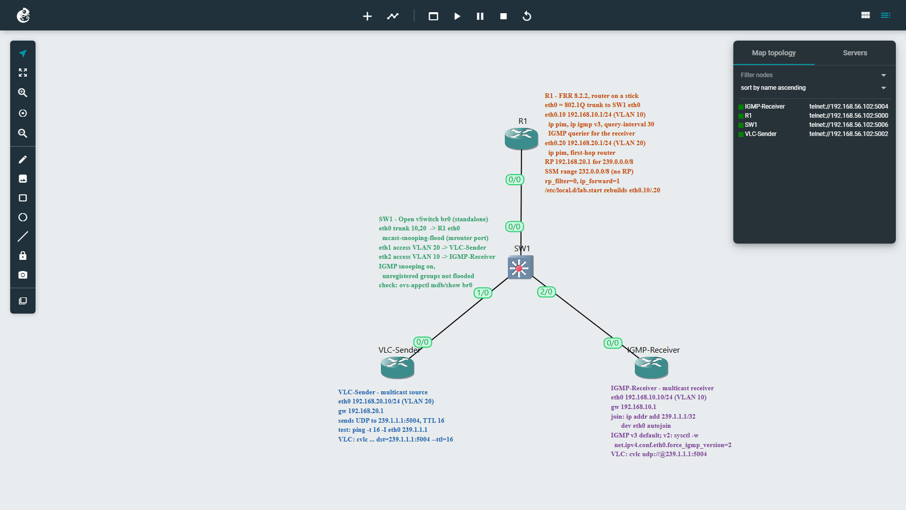

# Inter-VLAN Multicast on a Stick (FRR + Open vSwitch)

One FRR router routes a multicast stream from VLAN 20 to VLAN 10 over a single 802.1Q trunk. The switch is the GNS3 Open vSwitch appliance, with VLANs and IGMP snooping.

| Part | Job |
|---|---|
| **R1 (FRR)** | Router-on-a-stick (`eth0.10`, `eth0.20`), PIM-SM, RP `192.168.20.1`, IGMP querier on VLAN 10 |
| **SW1 (Open vSwitch)** | VLAN 10 and 20, trunk to R1, IGMP snooping |
| **VLC Sender** | Streams UDP to `239.1.1.1:5004` with TTL 16 in VLAN 20 |
| **IGMP Receiver** | Joins `239.1.1.1` (IGMPv2 or v3) in VLAN 10 and plays the stream |

The stream crosses the trunk twice: up tagged 20, routed by R1, back down tagged 10. R1 decrements the TTL from 16 to 15.

The lab runs on the GNS3 server on the Ubuntu VM (`192.168.56.102:3080`) as project **VLAN-Multicast-OVS**.

> **Why not a Cisco IOSvL2 or Arista vEOS switch?** Both need KVM. Turning on VirtualBox nested virtualization gives the Ubuntu VM `/dev/kvm`, but on this AMD host the VM crashed (`VERR_SVM_UNKNOWN_EXIT`) as soon as GNS3 started KVM nodes. The server runs QEMU without KVM, so the lab uses Open vSwitch, a lightweight Docker container.

## Topology



The screenshot shows the running project in the GNS3 web UI. Each node has a note with its addresses, VLANs, role and test commands; [notes.sh](notes.sh) adds them. The original design called SW1's ports `e0`, `e1`, `e2`; on Open vSwitch they are `eth0`, `eth1`, `eth2`. The web UI labels the cable ends by adapter number, so `1/0` on SW1 is eth1.

### Nodes

| Node | GNS3 node | RAM |
|---|---|---|
| R1 | FRR 8.2.2 (QEMU, template **FRR**) | 256 MB |
| SW1 | Open vSwitch (Docker, template **Open vSwitch**) | — |
| VLC-Sender | Linux host (an FRR node with all FRR daemons off) | 256 MB |
| IGMP-Receiver | Linux host | 256 MB |

VPCS can't send or join multicast, so both hosts must be Linux hosts.

### Links and addressing

| Link | A | B (SW1) | SW1 port mode |
|---|---|---|---|
| R1 – SW1 | R1 eth0 | **eth0** (e0) | trunk, VLANs 10, 20 |
| Sender – SW1 | VLC-Sender eth0 | **eth1** (e1) | access VLAN 20 |
| Receiver – SW1 | IGMP-Receiver eth0 | **eth2** (e2) | access VLAN 10 |

| VLAN | Subnet | Gateway (R1) | Host |
|---|---|---|---|
| 10 | 192.168.10.0/24 | eth0.10, 192.168.10.1 | IGMP-Receiver, 192.168.10.10 |
| 20 | 192.168.20.0/24 | eth0.20, 192.168.20.1 (also the RP) | VLC-Sender, 192.168.20.10 |

### Config files

| Node | File | Where to run it |
|---|---|---|
| SW1 | [configs/SW1-ovs.sh](configs/SW1-ovs.sh) | SW1 console (root shell) |
| R1 | [configs/R1.conf](configs/R1.conf) | R1 vtysh, after the shell script in step 3 |
| VLC-Sender, IGMP-Receiver | commands in step 4 | Host shell |

---

## 1. Build the topology

1. In a new project, add **R1** from the **FRR** template, **SW1** from the **Open vSwitch** template, and two more **FRR** nodes named **VLC-Sender** and **IGMP-Receiver**.
2. Cable everything as in the links table, using the exact `ethX` ports.
3. Start all nodes. Without KVM, the FRR nodes take about a minute to boot.
4. Optional: run [notes.sh](notes.sh) from Git Bash or Linux to put a text note beside each node, with its addresses, VLANs, role and test commands. It needs only `curl` and `perl`, and it's safe to re-run: it replaces its own old notes. Set `GNS3=<server IP>` or `PROJECT_NAME=<name>` if yours differ.

> **Turn off auto-close** if you drive the lab from scripts or the API: right-click the project → **Edit project** → clear **Close the project when the last client leaves**. Otherwise GNS3 closes the project and stops every node when no browser is connected.

## 2. Configure SW1 (Open vSwitch)

Open the SW1 console. It's a root shell inside the container. The GNS3 image creates bridge `br0` with every `ethX` in it, as untagged ports in one flat network. Paste the commands from [configs/SW1-ovs.sh](configs/SW1-ovs.sh):

```sh
for p in eth3 eth4 eth5 eth6 eth7; do ovs-vsctl --if-exists del-port br0 $p; done
ovs-vsctl set port eth0 vlan_mode=trunk trunks=10,20
ovs-vsctl set port eth1 vlan_mode=access tag=20
ovs-vsctl set port eth2 vlan_mode=access tag=10
ovs-vsctl set-fail-mode br0 standalone
ovs-vsctl set bridge br0 mcast_snooping_enable=true \
  other_config:mcast-snooping-disable-flood-unregistered=true \
  other_config:mcast-snooping-aging-time=300
ovs-vsctl set port eth0 other_config:mcast-snooping-flood=true \
  other_config:mcast-snooping-flood-reports=true
```

| Setting | Why |
|---|---|
| `vlan_mode=trunk trunks=10,20` | eth0 carries VLANs 10 and 20 tagged, like a Cisco `switchport mode trunk` with `allowed vlan 10,20`. Untagged frames are dropped. |
| `vlan_mode=access tag=N` | Host ports, untagged, in one VLAN |
| `set-fail-mode br0 standalone` | Plain MAC-learning switch. No OpenFlow controller is used. |
| `mcast_snooping_enable=true` | IGMP snooping: forward a group only to ports that joined it |
| `mcast-snooping-disable-flood-unregistered=true` | Groups that nobody joined aren't flooded to every port |
| `mcast-snooping-flood=true` on eth0 | Makes eth0 the **multicast router port**. R1 sends IGMP queries only on VLAN 10, so without this, SW1 never learns where the router is in VLAN 20 and drops the source's traffic. |
| `mcast-snooping-flood-reports=true` on eth0 | Sends the receiver's IGMP reports to R1 |

The settings are kept in the container's OVS database and survive a node stop and start.

**Check:**

```sh
ovs-vsctl --columns=name,tag,trunks,vlan_mode list port eth0 eth1 eth2
ovs-appctl fdb/show br0      # MAC table: R1's MAC on eth0 (port 1) in VLAN 10 and 20
ovs-appctl mdb/show br0      # snooping table: 239.1.1.1 on the receiver's port once it joins
```

## 3. Configure R1 (FRR)

The FRR console opens at `frr#` (vtysh). Type `exit` to get a Linux shell.

**Daemons, subinterfaces and kernel settings.** These go in a startup script, because the subinterfaces don't survive a reboot:

```sh
sed -i -E 's/^(bgpd|ospfd|ospf6d|ripd|ripngd|isisd|ldpd|bfdd|eigrpd)=yes/\1=no/; s/^pimd=no/pimd=yes/' /etc/frr/daemons

cat > /etc/local.d/lab.start <<'EOF'
#!/bin/sh
modprobe 8021q 2>/dev/null
ip link set eth0 up
ip link add link eth0 name eth0.10 type vlan id 10 2>/dev/null
ip link add link eth0 name eth0.20 type vlan id 20 2>/dev/null
ip link set eth0.10 up
ip link set eth0.20 up
for f in /proc/sys/net/ipv4/conf/*/rp_filter; do echo 0 > $f; done
sysctl -qw net.ipv4.ip_forward=1
EOF
chmod +x /etc/local.d/lab.start
rc-update add local default
/etc/local.d/lab.start
rc-service frr restart
```

**Routing, PIM and IGMP:**

```
vtysh
configure terminal
  (paste the contents of configs/R1.conf)
end
write memory
```

[configs/R1.conf](configs/R1.conf) does the following:

- **`ip pim` on both subinterfaces.** On `eth0.20`, R1 is the first-hop router and the RP. On `eth0.10`, it's the last-hop router.
- **`ip igmp` with version 3 on `eth0.10`.** R1 becomes the IGMP querier for VLAN 10. An IGMPv3 router also accepts v2 reports, so both receiver tests work without changing R1.
- **`ip igmp query-interval 30`.** General queries go out every 30 seconds instead of every 125, so snooping and group state recover faster in the lab.
- **`ip pim rp 192.168.20.1 239.0.0.0/8`.** The RP is R1's own VLAN 20 address. `232.0.0.0/8` is FRR's default SSM range, and it never uses an RP.

## 4. Configure the hosts

On each host, `exit` to the shell. Turn FRR off and set the address. To keep these settings after a reboot, put them in `/etc/local.d/lab.start` as in step 3.

**VLC-Sender:**

```sh
sed -i -E 's/^([a-z0-9]+d)=yes/\1=no/' /etc/frr/daemons && rc-service frr restart
ip link set eth0 up
ip addr add 192.168.20.10/24 dev eth0
ip route replace default via 192.168.20.1
```

**IGMP-Receiver:**

```sh
sed -i -E 's/^([a-z0-9]+d)=yes/\1=no/' /etc/frr/daemons && rc-service frr restart
ip link set eth0 up
ip addr add 192.168.10.10/24 dev eth0
ip route replace default via 192.168.10.1
sysctl -w net.ipv4.icmp_echo_ignore_broadcasts=0    # reply to pings sent to the group
```

**Choose the receiver's IGMP version.** Linux uses IGMPv3 by default.

```sh
sysctl -w net.ipv4.conf.eth0.force_igmp_version=2   # IGMPv2
sysctl -w net.ipv4.conf.eth0.force_igmp_version=0   # back to the default (v3)
```

Check unicast first. From the receiver, `ping 192.168.20.10` should get replies through R1.

## 5. Test B: PIM-SM

The test follows four steps:

**① and ② The receiver joins.** On IGMP-Receiver:

```sh
ip addr add 239.1.1.1/32 dev eth0 autojoin     # sends an unsolicited IGMP report
```

**③ R1 queries.** Wait up to 30 seconds, then check:

| Where | Command | Expect |
|---|---|---|
| R1 | `show ip igmp interface` | `eth0.10` is the querier, at 192.168.10.1 |
| R1 | `show ip igmp groups` | `239.1.1.1` on `eth0.10` |
| R1 | `show ip pim rp-info` | RP `192.168.20.1` for `239.0.0.0/8` |
| SW1 | `ovs-appctl mdb/show br0` | VLAN 10, `239.1.1.1`, on the receiver's port (eth2, OpenFlow port 3) |

**④ The sender sends.** On VLC-Sender, use ping as a quick test:

```sh
ping -t 16 -I eth0 239.1.1.1
```

Replies come back from `192.168.10.10`. Linux sends multicast with TTL 1 by default, so `-t 16` is needed. With TTL 1, R1 would drop the packets.

On R1:

```
show ip mroute                  ! (192.168.20.10, 239.1.1.1)  iif eth0.20  oif eth0.10
show ip pim upstream            ! (S,G) Joined
```

### Stream video with VLC

Install VLC on both hosts. The [eBGP + PIM-SM lab, step 7](../eBGP-PIM-SM/README.md#7-stream-video-with-vlc) covers it: 256 MB of RAM, a temporary NAT link, `apk add vlc`, a `vlc` user, and the test clip.

Start the receiver first:

```sh
su vlc -c "cvlc -I dummy udp://@239.1.1.1:5004 --sout file/ts:/tmp/rx.ts"
```

Then start the sender:

```sh
su vlc -c "cvlc -I dummy --loop /home/vlc/bbb.mp4 --sout '#std{access=udp,mux=ts,dst=239.1.1.1:5004}' --ttl=16"
```

While the stream runs, `ls -la /tmp/rx.ts` on the receiver shows the file growing.

### SSM test: (192.168.20.10, 232.1.1.1), IGMPv3 only, no RP

With SSM, the receiver names the source as well as the group. That needs IGMPv3, so set `force_igmp_version=0` on the receiver first.

Receiver (VLC's `source@group` syntax sends an IGMPv3 source-specific join):

```sh
su vlc -c "cvlc -I dummy udp://192.168.20.10@232.1.1.1:5004 --sout file/ts:/tmp/rx-ssm.ts"
```

Sender:

```sh
su vlc -c "cvlc -I dummy --loop /home/vlc/bbb.mp4 --sout '#std{access=udp,mux=ts,dst=232.1.1.1:5004}' --ttl=16"
```

On R1, `show ip igmp sources` lists `192.168.20.10` for `232.1.1.1`, and `show ip mroute` shows the (S,G) entry built without the RP. If you force the receiver to IGMPv2, the stream stops: a v2 report can't name a source.

## 6. Test A: static multicast (no PIM routing)

This test forwards the same stream with a hand-made (S,G) entry, without the RP or any PIM joins. pimd still has to manage the interfaces, so `ip pim` stays on them.

```
vtysh
configure terminal
 no ip pim rp 192.168.20.1 239.0.0.0/8
 interface eth0.20
  ip mroute eth0.10 239.1.1.1 192.168.20.10
end
show ip mroute                  ! the entry shows protocol STATIC
```

Run the sender's ping or VLC stream again. Traffic still reaches the receiver in VLAN 10, even though there's no RP. To go back to Test B, remove the static route and restore the RP:

```
configure terminal
 interface eth0.20
  no ip mroute eth0.10 239.1.1.1 192.168.20.10
 exit
 ip pim rp 192.168.20.1 239.0.0.0/8
end
```

## Troubleshooting

| Symptom | Cause / fix |
|---|---|
| Hosts can't ping R1 | On SW1, check `ovs-vsctl --columns=name,tag,trunks list port eth0 eth1 eth2` (eth0 trunks `[10, 20]`, eth1 tag 20, eth2 tag 10) and that each cable is on the right `ethX`. On R1, check that the lab script ran (`ip link` lists `eth0.10@eth0` UP). |
| R1 lists the group, but the receiver gets nothing | Most likely IGMP snooping on SW1. Check `ovs-appctl mdb/show br0` lists `239.1.1.1` on the receiver's port, and that eth0 has `mcast-snooping-flood=true`. As a test, turn snooping off: `ovs-vsctl set bridge br0 mcast_snooping_enable=false`. If traffic then flows, the snooping state is the problem. |
| A node's console refuses connections, and stop/start on it times out | A GNS3 2.2.61 console bug seen in this lab. Restart the server on the VM with `sudo systemctl restart gns3-server`, reopen the project and start the nodes. Their configs are kept. |
| `show ip mroute` has no entry | The sender's TTL is 1 (use `-t 16` / `--ttl=16`), or `rp_filter` is on. Check `sysctl net.ipv4.conf.all.rp_filter` on R1 (must be `0`). |
| SSM stream doesn't arrive | The receiver is forced to IGMPv2, or R1's `eth0.10` isn't at IGMP version 3 (`show ip igmp interface`). |
| Everything breaks after R1 restarts | The subinterfaces are rebuilt by `/etc/local.d/lab.start`. Run it by hand, then `rc-service frr restart`. |
